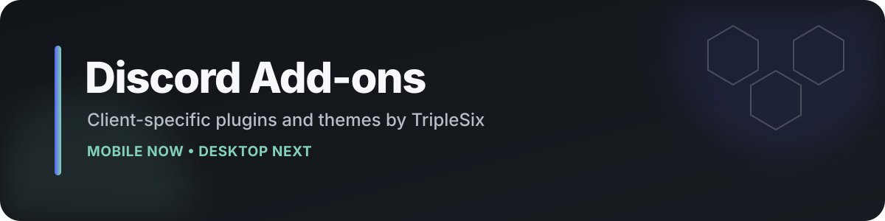

  

  
  
  
  

  <a href="#mobile-clients">Mobile</a> ·
  <a href="#plugin-matrix">Plugins</a> ·
  <a href="#themes">Themes</a> ·
  <a href="#desktop-clients">Desktop</a> ·
  <a href="#development-channels">Development</a>

**Useful Discord changes without turning the repository into a junk drawer.**

This is the stable home for my Discord plugins, themes, and client-specific add-ons. Mobile builds are separated by client so the right code lands on the right Discord mod. Desktop support has its own reserved section and will fill out only when those builds are actually ready.

> **Use the build for your client.** Discord internals change often, and a plugin built for ShiggyCord is not automatically interchangeable with Revenge Classic, Vencord, Equicord, or another client.

## Mobile clients

### ShiggyCord

The actively maintained ShiggyCord collection currently has **8 stable plugins**.

[Browse ShiggyCord builds →](clients/shiggycord/plugins/) · [Quick-install list →](clients/shiggycord/plugins/README.md)

### Revenge Classic

The retained Revenge Classic collection currently has **7 stable plugins**, including Theme Toolkit.

[Browse Revenge Classic builds →](clients/revenge-classic/)

## Plugin matrix

| Add-on | What it does | ShiggyCord | Revenge Classic |
| --- | --- | :---: | :---: |
| **Account Switcher** | Native-style multi-account switching using Discord's saved-account system. The ShiggyCord build also keeps Android push registration focused on the active account. | [Install](https://raw.githubusercontent.com/OnlyTripleSix/discord-addons/main/clients/shiggycord/plugins/account-switcher/) | [Install](https://raw.githubusercontent.com/OnlyTripleSix/discord-addons/main/plugins/account-switcher/) |
| **Composer Cleaner** | Hides selected native composer controls without removing third-party composer plugins. | [Install](https://raw.githubusercontent.com/OnlyTripleSix/discord-addons/main/clients/shiggycord/plugins/composer-cleaner/) | [Install](https://raw.githubusercontent.com/OnlyTripleSix/discord-addons/main/plugins/composer-cleaner/) |
| **Hidden Channels** | Shows inaccessible channel metadata already present locally. Does **not** bypass server permissions or grant message access. | [Install](https://raw.githubusercontent.com/OnlyTripleSix/discord-addons/main/clients/shiggycord/plugins/hidden-channels/) | [Install](https://raw.githubusercontent.com/OnlyTripleSix/discord-addons/main/plugins/hidden-channels/) |
| **Hide Call Buttons** | Hides DM, profile, Friends-list, and voice-panel call controls with lazy ShiggyCord hooks. | [Install](https://raw.githubusercontent.com/OnlyTripleSix/discord-addons/main/clients/shiggycord/plugins/hide-call-buttons/) | — |
| **Purge Tools** | Previewed bulk message/reaction cleanup with pacing, verification, media protection, and resume checkpoints. | [Install](https://raw.githubusercontent.com/OnlyTripleSix/discord-addons/main/clients/shiggycord/plugins/purge-tools/) | [Install](https://raw.githubusercontent.com/OnlyTripleSix/discord-addons/main/plugins/purge-tools/) |
| **Quick Mock** | Alternating-case mock text through slash, reply, and long-press workflows. | [Install](https://raw.githubusercontent.com/OnlyTripleSix/discord-addons/main/clients/shiggycord/plugins/quick-mock/) | [Install](https://raw.githubusercontent.com/OnlyTripleSix/discord-addons/main/plugins/quick-mock/) |
| **Settings Pins** | Pins plugin settings into ShiggyCord and can hide existing non-core shortcuts. | [Install](https://raw.githubusercontent.com/OnlyTripleSix/discord-addons/main/clients/shiggycord/plugins/settings-pins/) | — |
| **Silent Typing** | Adds a customizable composer toggle that suppresses Discord typing events while enabled. | [Install](https://raw.githubusercontent.com/OnlyTripleSix/discord-addons/main/clients/shiggycord/plugins/silent-typing/) | [Install](https://raw.githubusercontent.com/OnlyTripleSix/discord-addons/main/plugins/silent-typing/) |
| **Theme Toolkit** | Create, edit, save, preview, export, and share Discord themes. | — | [Install](https://raw.githubusercontent.com/OnlyTripleSix/discord-addons/main/plugins/theme-toolkit/) |

### Installing mobile plugins

Copy the **raw directory URL** from the table into your client's plugin manager.

For ShiggyCord, use the `clients/shiggycord/plugins/` paths. The root `plugins/` URLs are retained for the Revenge Classic release layout and existing compatibility.

## Purge Tools account-risk notice

> **Personally, Purge Tools has worked fine for me. Discord can still restrict or ban accounts for activity it considers abusive or automated. Use it at your own risk. I am not responsible for account restrictions, suspensions, or bans.**

This applies to both ShiggyCord and Revenge Classic builds.

## Themes

### AMOLED Monochrome

Pure-black OLED theme with white and gray UI accents.

[Get AMOLED Monochrome →](https://raw.githubusercontent.com/OnlyTripleSix/discord-addons/main/themes/amoled-monochrome.json)

### Theme Toolkit

Theme Toolkit remains **Revenge Classic-only** for now. It is intentionally separate from the ShiggyCord plugin set.

[Open Theme Toolkit →](plugins/theme-toolkit/)

## Desktop clients

**Reserved for future releases — nothing here is being presented as finished desktop support yet.**

| Desktop target | Status | Direction |
| --- | --- | --- |
| **[Official Discord + Vencord](clients/vencord/)** | Planned | Primary desktop target: keep official Discord feature parity while adding custom privacy and quality-of-life behavior. |
| **[Equicord](clients/equicord/)** | Evaluating | Compatibility target where the larger plugin/custom-plugin ecosystem makes sense. |
| **Desktop releases** | Not published yet | Stable install links appear here only after a build has been made and tested. |

Desktop work will stay in its own client directories instead of being mixed into the mobile release folders.

## Compatibility

Discord updates can move or replace internal modules. A stable build means it was promoted from staging after testing; it does **not** mean Discord can never break it later.

If something suddenly stops working after a Discord update, check the client-specific build first.

## Development channels

| Repository | Purpose |
| --- | --- |
| **[discord-addons](https://github.com/OnlyTripleSix/discord-addons)** | Stable public releases |
| **[discord-addons-staging](https://github.com/OnlyTripleSix/discord-addons-staging)** | Public testing and refetch candidates |
| `discord-addons-workbench` | Private development, experiments, and unreleased source |
| **[ShiggyCord](https://github.com/OnlyTripleSix/ShiggyCord)** | Public source fork used for upstream/source work |

## License and attribution

Repository-owned code is available under the [MIT License](LICENSE) unless a plugin says otherwise.

**Hide Call Buttons** is derived from John / `janisslsm`'s BSD-3-Clause work and retains its required license and attribution inside the plugin folder.

Discord is a trademark of Discord Inc. This repository is independent and is not affiliated with or endorsed by Discord.
